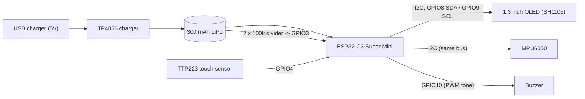
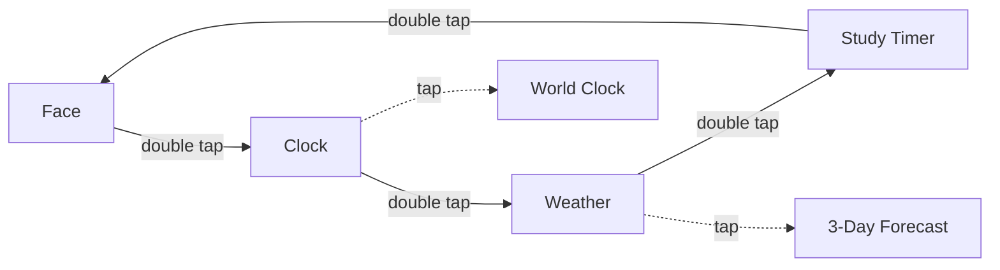
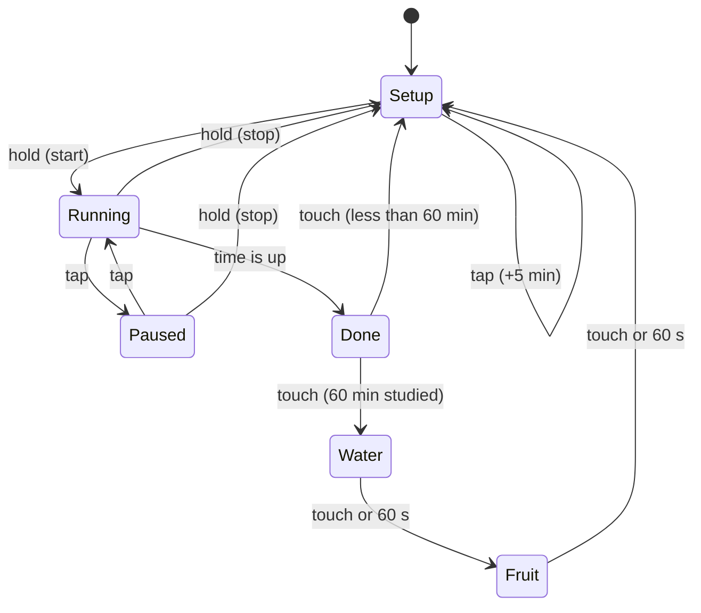

<div align="center">

# 🤖 Ollie — The Tiny Desk Robot

**A pocket-sized, emotional desk companion built on an ESP32-C3.**
It shows live time and weather, reacts to touch and motion with 13 hand-drawn emotions, studies with you using a built-in study timer, and reminds you to drink water and eat fruit.

*powered by Anu* ❤️


<!-- Add your own photos / GIFs here -->
<!--  -->

</div>

---

## 📖 Table of Contents

1. [About the project](#-about-the-project)
2. [Feature overview](#-feature-overview)
3. [Demo](#-demo)
4. [Hardware](#-hardware)
5. [Wiring and pinout](#-wiring-and-pinout)
6. [Power system and battery safety](#-power-system-and-battery-safety)
7. [Software setup](#-software-setup)
8. [Configuration reference](#-configuration-reference)
9. [First boot walk-through](#-first-boot-walk-through)
10. [Using Ollie: controls](#-using-ollie-controls)
11. [Pages in detail](#-pages-in-detail)
12. [The 13 emotions](#-the-13-emotions)
13. [Study timer and health reminders](#-study-timer-and-health-reminders)
14. [Status bar: WiFi, timer badge, battery](#-status-bar-wifi-timer-badge-battery)
15. [Motion sensing (MPU6050)](#-motion-sensing-mpu6050)
16. [Sound design](#-sound-design)
17. [Networking, time and weather](#-networking-time-and-weather)
18. [How the firmware works](#-how-the-firmware-works)
19. [Customization recipes](#-customization-recipes)
20. [Troubleshooting](#-troubleshooting)
21. [Security: keep your secrets out of Git](#-security-keep-your-secrets-out-of-git)
22. [Project structure](#-project-structure)
23. [Roadmap](#-roadmap)
24. [FAQ](#-faq)
25. [Credits and license](#-credits-and-license)

---

## 💡 About the project

**Ollie** is a handmade desk robot with a tiny OLED "face". Instead of being just another clock, Ollie has a personality: it blinks, looks around, laughs, blushes, gets excited, falls in love when you pet it, and gets *very* angry if you disturb it while it is studying.

Under the hood it is a single Arduino sketch (`Ollie_Master.ino`) running on an **ESP32-C3 Super Mini**. Everything you see on the screen (eyes, hearts, stars, the reading book, the water glass, the apple, the WiFi and battery icons) is drawn in code with simple graphics primitives, so there are almost no bitmaps and the whole thing fits comfortably in flash.

Ollie was designed as a **gift**, so the focus is on charm and usefulness together:

- 🕒 a clock and world clock that sync themselves over WiFi,
- ☀️ live weather and a 3-day forecast,
- 📚 a **study timer** (5 to 60 minutes) where Ollie literally reads a book next to you,
- 💧🍎 **health reminders** (drink water, then eat fruit) after every 60 minutes of study,
- 🔋 a **battery gauge** and **WiFi status** that are always visible on the top bar,
- 🎭 13 emotions that react to touch, shaking, weather and time.

---

## ✨ Feature overview

| Area | What Ollie does |
|---|---|
| **Face** | 13 emotions drawn with vector shapes, natural blinking, breathing motion, eyes that follow the tilt of the device |
| **Interaction** | Tap, double tap, triple tap and long press on a single touch sensor, each with a different meaning per page |
| **Petting** | Hold the touch sensor to pet Ollie: it cycles through Love, Shy and Kiss faces with cute sounds |
| **Poke** | Tap the face for a random reaction. During study mode the same tap makes Ollie **angry** with one of 5 loud beep styles |
| **Motion** | MPU6050 detects shaking: Ollie gets **dizzy**, then **angry**. Tilt moves the eyes |
| **Clock** | 12-hour clock with AM/PM and date, auto-synced with NTP |
| **World clock** | India, London, New York with correct daylight-saving rules |
| **Weather** | Live temperature, humidity, feels-like and description from OpenWeather, refreshed every 10 minutes |
| **Forecast** | 3-day forecast with icons |
| **Study timer** | 5 to 60 minutes in 5-minute steps, pause/resume, progress bar, loud alarm |
| **Study mode** | Ollie reads from a mini book (eyes scan line by line, pages turn) while the timer runs |
| **Reminders** | After every 60 minutes of total study: *Drink Water* screen, then *Eat Fruits* screen, each with loud repeating beeps |
| **Status bar** | Animated WiFi icon, live timer badge, battery icon with percentage (or `USB` if no battery is detected) |
| **Sound** | Non-blocking sound engine: boot chime, UI clicks, alarm, reminders, pet chirps, 5 angry styles |
| **Robustness** | OLED address and pin auto-detection, optional MPU6050, automatic WiFi reconnect, graceful fallbacks |

---

## 🎬 Demo

> Add your videos and photos to a `media/` folder and link them here.

```markdown
https://github.com/<your-username>/<your-repo>/assets/....   <- drag your MP4 into the GitHub editor to get this link
```

A typical session in the demo video shows, in order: power-on boot screen, WiFi connection, idle emotions, petting, the clock, world clock, weather, forecast, setting the study timer, starting it, Ollie reading, getting angry when poked, and getting dizzy when shaken.

---

## 🧰 Hardware

### Bill of materials

| # | Component | Qty | Purpose | Notes |
|---|---|---|---|---|
| 1 | **ESP32-C3 Super Mini** ("ESP32-C3 Mini") | 1 | Brain: WiFi, I2C, ADC, PWM | Single-core RISC-V, 4 MB flash, USB-C |
| 2 | **1.3" OLED, 128×64, I2C** (SH1106 driver) | 1 | Ollie's face and all pages | Usually address `0x3C`. SSD1306 variants are supported via one switch |
| 3 | **MPU6050** (GY-521 module) | 1 | Tilt and shake detection | I2C address `0x68`. Optional, Ollie runs without it |
| 4 | **Touch sensor module (TTP223)** | 1 | Tap / hold input | The ESP32-C3 has **no built-in capacitive touch**, so an external module is required |
| 5 | **Buzzer** (passive recommended) | 1 | All sounds | Passive = real tones and melodies. Active buzzers also work (ON/OFF only) |
| 6 | **TP4056 charging module** | 1 | Charges the LiPo battery over USB | Prefer the version **with protection** (DW01 + FS8205A) |
| 7 | **300 mAh 3.7 V LiPo battery** | 1 | Portable power | Single-cell Li-ion/LiPo |
| 8 | **2 × 100 kΩ resistors** | 2 | Voltage divider for the battery gauge | Any 1% or 5% resistors work |
| 9 | Jumper wires, solder, switch (optional) | – | Wiring | A small slide switch on the battery line is nice to have |
| 10 | Enclosure | 1 | Housing | Any small box. The screen window should line up with the OLED |

> **Note on the TP4056:** it is often written as "TPU" or "TP-4056". It is the very common 1-cell lithium charger board with a micro-USB or USB-C input.

### Optional parts

- 0.1 µF ceramic capacitor between the divider midpoint and GND (smoother battery readings).
- Small slide switch between battery and the ESP32 (so Ollie can be turned off completely).

---

## 🔌 Wiring and pinout

### System block diagram



### Pin table

| Signal | ESP32-C3 pin | Connects to | Notes |
|---|---|---|---|
| **SDA** | `GPIO8` | OLED SDA and MPU6050 SDA | Shared I2C bus |
| **SCL** | `GPIO9` | OLED SCL and MPU6050 SCL | Shared I2C bus |
| **Touch** | `GPIO4` | TTP223 `OUT` | Configured as `INPUT_PULLDOWN` |
| **Buzzer** | `GPIO10` | Buzzer `+` (other leg to GND) | LEDC PWM tone output |
| **Battery sense** | `GPIO3` | Midpoint of the 2 × 100 kΩ divider | ADC1, 11 dB attenuation |
| **3V3** | `3V3` | OLED VCC, MPU6050 VCC, TTP223 VCC | |
| **GND** | `GND` | Everything's ground | **All grounds must be common** |

> **Auto-detection:** if the OLED is not found on `GPIO8/GPIO9`, the firmware scans other pin pairs (0, 1, 2, 3, 4, 5, 6, 7, 8, 9, 10, 20, 21, skipping the touch, buzzer and battery pins) and shows the working `SDA`/`SCL` numbers on the screen for 7 seconds so you can hard-code them.

### Wiring checklist

1. OLED: `VCC → 3V3`, `GND → GND`, `SDA → GPIO8`, `SCL → GPIO9`.
2. MPU6050: `VCC → 3V3`, `GND → GND`, `SDA → GPIO8`, `SCL → GPIO9` (leave `AD0` unconnected or low for address `0x68`).
3. TTP223: `VCC → 3V3`, `GND → GND`, `OUT → GPIO4`.
4. Buzzer: `+ → GPIO10`, `- → GND`.
5. Battery gauge divider (see below) → `GPIO3`.
6. Power (see below).

---

## 🔋 Power system and battery safety

### Power wiring

```
 USB cable ──► TP4056 IN+ / IN-
                  │
 LiPo + ──────► TP4056 B+ ──┬──► ESP32-C3 5V pin   (power)
                            │
                            ├──[ 100 kΩ ]──┬──[ 100 kΩ ]──┐
                            │              │              │
                            │         ESP32 GPIO3         │
                            │                             │
 LiPo - ──────► TP4056 B- ──┴─────────────────────────────┴──► ESP32 GND
```

- Take the divider and the power feed from the **battery side** (`B+` / `B-`), or from `OUT+` / `OUT-` if your module has protected outputs. Do **not** take it from the USB side.
- The divider halves the battery voltage (4.2 V becomes 2.1 V), which is safe for the ESP32 ADC. The firmware multiplies the reading by `BATTERY_DIVIDER` (default `2.0`) to get the real voltage.
- The divider continuously draws only about 20 µA, which is negligible.
- **Never connect the battery + directly to a GPIO pin.** 4.2 V will damage it.

### ⚠️ Charging current: change it for a 300 mAh cell

Most TP4056 boards are set to **1 A** charge current by a 1.2 kΩ `PROG` resistor. For a 300 mAh battery that is more than 3C, which is too fast and unsafe. Replace the `PROG` resistor (usually marked `122`) to reduce the current:

| `PROG` resistor | Charge current (approx.) | Suitable for 300 mAh? |
|---|---|---|
| 1.2 kΩ (default) | 1000 mA | ❌ Too high |
| 4.7 kΩ | ~255 mA | ✅ (about 0.85C) |
| 5.1 kΩ | ~235 mA | ✅ |
| 8.2 kΩ | ~145 mA | ✅ gentle (about 0.5C) |
| 10 kΩ | ~120 mA | ✅ very gentle |

Formula: `I(mA) ≈ 1200 / R(kΩ)`.

### Other battery notes

- Use a **protected** TP4056 (the one with DW01 + FS8205A chips) so the cell is cut off at over-discharge and over-current.
- Feeding a LiPo into the Super Mini's `5V` pin works, but the onboard 3.3 V regulator will start to sag when the cell gets low (roughly below 3.5 V). That is normal for this setup.
- While charging, the measured voltage rises (charger voltage), so the percentage will read higher than reality. Unplug the charger for an accurate reading.
- **Runtime:** with WiFi connected and the OLED animating, expect roughly a few hours on a 300 mAh cell. This is an estimate, not a measurement. Measure it with your own build.

---

## 🛠 Software setup

### 1. Install Arduino IDE and the ESP32 board package

1. Install the [Arduino IDE](https://www.arduino.cc/en/software) (2.x recommended).
2. Open **File → Preferences** and add this to *Additional boards manager URLs*:
   `https://espressif.github.io/arduino-esp32/package_esp32_index.json`
3. Open **Tools → Board → Boards Manager**, search for **esp32** (by Espressif Systems) and install it.

### 2. Install libraries (Library Manager)

| Library | Author | Purpose |
|---|---|---|
| **Adafruit GFX Library** | Adafruit | Drawing primitives and text |
| **Adafruit SH110X** | Adafruit | SH1106 OLED driver |
| **Arduino_JSON** | Arduino | Parses OpenWeather responses |
| **MPU6050_tockn** | tockn | MPU6050 angles and acceleration |
| *Adafruit SSD1306* (optional) | Adafruit | Only if your OLED is an SSD1306 |

`WiFi`, `HTTPClient`, `Wire` and `time` are part of the ESP32 core.

### 3. Board settings

| Setting | Value |
|---|---|
| Board | **ESP32C3 Dev Module** |
| USB CDC On Boot | **Enabled** (needed to see `Serial` output) |
| Flash size | 4 MB |
| Upload speed | 921600 (lower it if uploads fail) |

> To enter download mode on a Super Mini: hold **BOOT**, tap **RESET**, release **BOOT**, then upload.

### 4. Edit your settings

Open `Ollie_Master/Ollie_Master.ino` and edit the **"YOUR SETTINGS"** block at the top:

```cpp
const char* WIFI_SSID           = "YOUR_WIFI_NAME";
const char* WIFI_PASSWORD       = "YOUR_WIFI_PASSWORD";
const char* OPENWEATHER_API_KEY = "YOUR_OPENWEATHER_KEY";
const char* CITY                = "Delhi";   // use %20 for spaces, e.g. "New%20Delhi"
const char* COUNTRY_CODE        = "IN";
const char* TIMEZONE            = "IST-5:30";

const char* ROBOT_NAME          = "Ollie";
const char* OWNER_NAME          = "Anu";     // boot screen: "powered by Anu"
const char* LOCAL_LABEL         = "IND";     // first column of the world clock
```

### 5. Get a free OpenWeather API key

1. Create a free account at [openweathermap.org](https://openweathermap.org).
2. Open **My API keys** and copy the default key.
3. A new key can take from several minutes up to a couple of hours to activate. Do not regenerate it while waiting.
4. Test it in a browser (replace the placeholders):

```
https://api.openweathermap.org/data/2.5/weather?q=YourCity,IN&appid=YOUR_KEY&units=metric
```

A JSON reply with `"temp"` means it works. `"cod":401` means the key is not active yet or is wrong. `"cod":"404"` means the city name was not found.

### 6. WiFi requirements

The ESP32-C3 supports **2.4 GHz only**. If you use a phone hotspot, switch its band to 2.4 GHz (on iPhone enable *Maximize Compatibility*).

### 7. Upload

Select the correct COM port and press **Upload**. Open the Serial Monitor at `115200` baud to see diagnostic messages.

---

## ⚙️ Configuration reference

All user-facing options live at the top of the sketch.

| Option | Default | Description |
|---|---|---|
| `WIFI_SSID`, `WIFI_PASSWORD` | – | Your 2.4 GHz network |
| `OPENWEATHER_API_KEY` | – | Your OpenWeather key |
| `CITY`, `COUNTRY_CODE` | `Delhi`, `IN` | Weather location |
| `TIMEZONE` | `IST-5:30` | POSIX timezone string used for the local clock |
| `ROBOT_NAME` | `Ollie` | Shown on the boot screen |
| `OWNER_NAME` | `Anu` | Boot tagline: `powered by <name>` |
| `LOCAL_LABEL` | `IND` | Label of the first world-clock column |
| `LOW_TX_POWER_FIX` | `1` | Lowers WiFi TX power. Fixes connection problems on some Super Mini boards |
| `REMINDER_EVERY_MIN` | `60` | Study minutes before the water and fruit reminders |
| `USE_SSD1306` | `0` | Set to `1` if your OLED is an SSD1306 instead of SH1106 |
| `SDA_PIN`, `SCL_PIN` | `8`, `9` | I2C pins (auto-scan if the OLED is not found) |
| `TOUCH_PIN` | `4` | Touch sensor input |
| `BUZZER_PIN` | `10` | Buzzer output |
| `BATTERY_PIN` | `3` | Battery ADC input |
| `BATTERY_ENABLED` | `1` | `0` hides the battery percentage and shows `USB` |
| `BATTERY_DIVIDER` | `2.0` | Divider ratio (two equal resistors give 2.0) |
| `BUZZER_ENABLED` | `1` | `0` mutes everything |
| `BUZZER_PASSIVE` | `1` | `1` = passive buzzer (tones), `0` = active buzzer (ON/OFF) |
| `BUZZER_CLICKS` | `1` | Short click on touch events |
| `timerSetMinutes` | `25` | Default study timer value |

---

## 🚀 First boot walk-through

When you power Ollie on you will see (and hear) this sequence:

| Step | On screen | Sound |
|---|---|---|
| 1 | Nothing yet | One short beep: *"firmware is alive"* |
| 2 | OLED is detected (if not: three long low beeps, then retry) | – |
| 3 | Expanding circle animation, then **"Ollie"** appears letter by letter, then *powered by Anu* in a small font | Three-note boot chime |
| 4 | *Calibrating... Keep device STILL* (only if an MPU6050 is present, about 1 second) | – |
| 5 | *Connecting WiFi* with progress dots (up to 15 seconds) | – |
| 6 | *WiFi Connected!*, then time sync and first weather fetch | – |
| 7 | Ollie's face appears and the top bar shows WiFi and battery | – |

If WiFi fails, Ollie shows *WiFi Failed! Will retry in bg* and keeps retrying every 30 seconds in the background.

---

## 👆 Using Ollie: controls

Ollie uses **one touch sensor** and decodes four gestures:

| Gesture | How |
|---|---|
| **Tap** | One short touch |
| **Double tap** | Two taps within 300 ms |
| **Triple tap** | Three taps within 300 ms |
| **Hold** | Keep touching for more than 800 ms |

### Gesture map

| Where | Tap | Hold | Double tap | Triple tap |
|---|---|---|---|---|
| **Face page** | Poke (random reaction, or *angry* while studying) | **Pet** Ollie (cute faces) | Next page | Cycle through all 13 emotions (demo) |
| **Clock page** | Toggle World clock | – | Next page | Back to Face |
| **Weather page** | Toggle 3-day forecast | – | Next page | Back to Face |
| **Timer page (setup)** | **+5 minutes** (wraps 60 → 5) | **Start** | Next page | Back to Face |
| **Timer page (running)** | Pause / resume | **Stop** | Next page | Back to Face |
| **Alarm or reminder** | Any touch dismisses it / moves to the next step | | | |

### Page flow



---

## 📄 Pages in detail

### 1. Face page
Ollie's home screen. The current emotion is chosen by a priority system (see [The 13 emotions](#-the-13-emotions)). Eyes blink every 2.2 to 6 seconds, the face gently "breathes", and the eyes follow the device's tilt (or wander randomly when no MPU6050 is fitted).

### 2. Clock page
- Large 12-hour time (`07:14`) with `AM` / `PM`.
- Date line (for example `Sun, Oct 25`).
- Time is fetched via NTP (`pool.ntp.org`, `time.google.com`) using the `TIMEZONE` string. Until the first sync it shows *Syncing...* (or *No WiFi*).
- **Tap** → **World clock**: three columns, **local** (label from `LOCAL_LABEL`), **LDN** (London) and **NYC** (New York). London and New York use real POSIX DST rules, so summer and winter time are always correct.

### 3. Weather page
- City name, big temperature with a degree mark, a weather icon (sun, cloud, rain), humidity with a droplet, feels-like temperature (`~31`), and the short description (for example *Scattered clouds*).
- Shows *No WiFi* or *Fetching weather* until data is available.
- **Tap** → **3-day forecast**: three columns (`MON`, `TUE`, `WED`) with mini icon and temperature. Day names are computed from today's date.

### 4. Study timer page
A large `mm:ss` countdown, a progress bar, a state caption (`STUDY TIMER`, `STUDYING...`, `PAUSED`, `TIME'S UP!`) and a hint line (for example `Tap:+5m  Hold:Start`). See the [next section](#-study-timer-and-health-reminders).

---

## 🎭 The 13 emotions

All faces are drawn procedurally. Every emotion is unique (no duplicates): Happy was merged into Normal, and Suspicious became Smirk.

| # | Emotion | Look | When it appears |
|---|---|---|---|
| 0 | **Normal** | Two rounded eyes and a small smile | Default, clear or normal weather |
| 1 | **Smirk** | Half-lidded eyes with an asymmetric lid and a one-sided smile | Idle expression, poke reaction |
| 2 | **Love** | Big beating heart eyes, small hearts floating up | Petting, idle, after a timer finishes |
| 3 | **Angry** | Slanted brows, zig-zag teeth, jagged spikes along the top and bottom edges, shaking | After a shake, or poke during study |
| 4 | **Laugh** | `> <` eyes and a big open mouth, bouncing | Idle, poke reaction |
| 5 | **Sleepy** | Heavy drooping lids, flat mouth, floating `Z z` | Very hot (> 35 °C) or cold (< 10 °C) weather, idle |
| 6 | **Shy** | Round eyes with highlights, blush lines, tiny `w` mouth, twinkling sparkles | Petting, idle, poke reaction |
| 7 | **Kiss** | One open eye, one winking `^` eye, puckered lips, a flying heart | Petting, idle |
| 8 | **Excited** | Pulsing 4-point star eyes, open smile, sparkles | Idle, poke reaction |
| 9 | **Sad** | Droopy slanted lids, frown, a falling tear | Rain or drizzle |
| 10 | **Surprised** | Wide round eyes with tiny pupils, round mouth | Thunderstorm, poke reaction |
| 11 | **Dizzy** | Rotating spiral eyes and a wavy mouth | While shaking |
| 12 | **Study** | Eyes scanning across an open book with text lines and page turns | While the study timer is running |

### How the current emotion is chosen (priority, highest first)

1. **Dizzy**: the device is being shaken
2. **Angry**: after a shake, or poked during study
3. **Petting**: Love → Shy → Kiss rotate every 1.5 seconds while held, and for 2.5 seconds after release
4. **Demo mode**: triple tap cycles through all 13 emotions (6 seconds each)
5. **Poke reaction**: a random Laugh, Surprised, Smirk, Shy or Excited for 2.5 seconds
6. **Celebration**: Love for 6 seconds after a timer or reminders finish
7. **Study**: while the timer is running
8. **Idle expression**: every 15 to 35 seconds Ollie randomly shows Smirk, Laugh, Shy, Kiss, Excited, Sleepy or Love for 3 to 5 seconds (never while studying)
9. **Base mood**: set by the weather

### Weather mood mapping

| Weather | Base mood |
|---|---|
| Clear | Normal |
| Rain / Drizzle | Sad |
| Thunderstorm | Surprised |
| Temperature > 35 °C | Sleepy |
| Temperature < 10 °C | Sleepy |
| Everything else | Normal |

---

## 📚 Study timer and health reminders

### Setting and running the timer

1. Double-tap until you reach the **Timer page**.
2. **Tap** to add 5 minutes at a time (5, 10, … 60, then it wraps back to 5). The default is 25 minutes.
3. **Hold** to start. Ollie jumps to the Face page and switches to the **Study** emotion.
4. While running, **tap** the Timer page to pause or resume, and **hold** to stop.
5. A small `mm:ss` badge in the top bar shows the remaining time on other pages (it blinks when paused).

### Study mode behaviour

- Ollie's eyes scan the book line by line, text lines appear one by one, and every ~11 seconds a page flips.
- **Poke** (tap on the face) while studying: Ollie becomes **very angry** for 3.2 seconds and plays a loud sound chosen at random from 5 styles.
- **Hold** (petting) still makes Ollie happy.

### When time is up

- The page switches to the Timer page and shows `TIME'S UP!`.
- A **loud siren-style alarm** plays in a loop (alternating 3300 Hz and 2300 Hz bursts) and the screen **flashes** (inverts every 500 ms).
- **Touch anything** to stop it. It also stops by itself after 45 seconds.

### Health reminders

Ollie keeps a running total of all your study minutes. When the total reaches `REMINDER_EVERY_MIN` (60 by default) the reminder sequence runs after you dismiss the alarm:

1. 💧 **DRINK WATER**: an animated glass with rising and falling water and bubbles, with loud repeating beeps.
2. 🍎 **EAT FRUITS**: a bouncing apple with a leaf and a shine, with loud repeating beeps.
3. 🎉 A celebration (Love face for 6 seconds and a happy jingle).

Each screen moves on when you touch it, or automatically after 60 seconds. After the reminders, the study counter resets to zero.

> Example: three 25-minute sessions add up to 75 minutes, so the reminders fire at the end of the third session. A single 60-minute session triggers them right away.

### Timer state machine



---

## 📶 Status bar: WiFi, timer badge, battery

A 9-pixel status bar is drawn on top of **every** page.

| Area | Shows |
|---|---|
| **Left: WiFi icon** | **Disconnected:** an empty, dotted icon with a blinking dot. **Connected:** the icon builds itself arc by arc (about 0.2 s per arc) into the full 3-arc symbol |
| **Middle: timer badge** | Remaining study time `mm:ss` while the timer runs (hidden on the Timer page itself, blinks when paused) |
| **Right: battery** | Battery outline filled according to charge, plus the percentage on its left. Blinks when below 15%. Shows `USB` if no battery divider is detected |

### How the battery percentage is calculated

1. Every 3 seconds the ADC on `GPIO3` is sampled 16 times (`analogReadMilliVolts`) and averaged.
2. The value is multiplied by `BATTERY_DIVIDER` (2.0) to get the real battery voltage.
3. If the voltage is below 2.5 V, Ollie assumes no battery or divider is connected and shows `USB`.
4. The voltage is smoothed (`new = 0.85 × old + 0.15 × sample`).
5. A 21-point LiPo discharge table converts voltage to percent with linear interpolation:

| Voltage | % | Voltage | % | Voltage | % |
|---|---|---|---|---|---|
| 4.20 | 100 | 3.91 | 65 | 3.77 | 30 |
| 4.15 | 95 | 3.87 | 60 | 3.75 | 25 |
| 4.11 | 90 | 3.85 | 55 | 3.73 | 20 |
| 4.08 | 85 | 3.84 | 50 | 3.71 | 15 |
| 4.02 | 80 | 3.82 | 45 | 3.69 | 10 |
| 3.98 | 75 | 3.80 | 40 | 3.61 | 5 |
| 3.95 | 70 | 3.79 | 35 | 3.27 | 0 |

---

## 🧭 Motion sensing (MPU6050)

The MPU6050 is **optional**. At boot the firmware probes address `0x68`. If found, it is initialised and calibrated; if not, Ollie works normally and the eyes wander on their own.

- **Calibration:** 100 samples over about 1 second while the device sits still. This sets the "level" reference, so place Ollie on the desk before powering on.
- **Gaze:** eye position follows roll and pitch (`roll / 4` limited to ±10 px horizontally, `pitch / 5` limited to ±5 px vertically).
- **Shake detection:** each loop the firmware sums the absolute change of the three acceleration axes, multiplied by 10. A value above **20** counts as a shake.
  - Only active on the **Face page**, and not during reminders.
  - Sequence: **Dizzy** for 1.5 s → **Angry** for 2 s (with a random angry sound).
- **Tuning:** to make shake detection more or less sensitive, change the `20.0` threshold in `updateMotion()`.

---

## 🔊 Sound design

Ollie has a small **non-blocking sound engine**. Sounds are short sequences of `(frequency, duration)` notes that play in the background, so the animation never freezes while a sound plays.

| Sound | Pattern | When |
|---|---|---|
| **Power-on beep** | 1 short 2000 Hz beep | Firmware started |
| **OLED error** | 3 long 400 Hz beeps | Display not found (retries) |
| **Boot chime** | 1800 → 2400 → 3000 Hz | Boot screen |
| **UI click** | 15 ms at 2600 Hz | Page change and timer taps |
| **Timer start** | 2000 → 3000 Hz | Timer started |
| **Timer stop** | 3000 → 1800 Hz | Timer stopped |
| **Alarm** | 5 × (3300 Hz + 2300 Hz) bursts, pause, repeat | Study timer finished |
| **Reminder** | 2800 Hz, 2800 Hz, long 3300 Hz, pause, repeat | Water and fruit screens |
| **Chirp** | 1800 → 2400 → 3000 Hz | Poke reaction |
| **Pet sound** | 2000 → 2600 → 2300 → 3100 Hz | Petting (each face change) |
| **Happy jingle** | Rising notes and a long high note | After reminders or a timer |
| **Angry style 1: Siren** | Alternating 3000 / 1800 Hz | Angry |
| **Angry style 2: Machine gun** | 14 rapid 3300 Hz blips | Angry |
| **Angry style 3: Screech** | Falling 3600 → 900 Hz | Angry |
| **Angry style 4: Rage "bzzt"** | Two 2200 Hz buzzes and a 3000 Hz blast | Angry |
| **Angry style 5: Warble** | Fast 2000 / 2700 Hz alternation | Angry |

### Making it louder

A buzzer's loudness is limited by hardware. The firmware already uses frequencies near typical buzzer resonance (about 2.7 to 3.3 kHz) and long continuous bursts. To go louder, drive the buzzer through an NPN transistor (for example 2N2222 or BC547) from the 5 V rail instead of directly from the GPIO pin.

---

## 🌐 Networking, time and weather

| Item | Details |
|---|---|
| **WiFi mode** | Station (client), 2.4 GHz |
| **Reconnect** | Tries again every 30 seconds in the background |
| **Time** | `configTzTime(TIMEZONE, "pool.ntp.org", "time.google.com")`. The boot waits up to 8 seconds for the first sync |
| **Time zones** | Local from `TIMEZONE`. London `GMT0BST,M3.5.0/1,M10.5.0`. New York `EST5EDT,M3.2.0,M11.1.0` (DST-aware) |
| **Weather API** | OpenWeather `data/2.5/weather` (current) and `data/2.5/forecast` (5-day / 3-hour) with `units=metric` |
| **Fields used** | `temp`, `feels_like`, `humidity`, `weather[0].main`, `weather[0].description` |
| **Forecast** | Entries 7, 15 and 23 of the 3-hourly list, which are roughly 24, 48 and 72 hours ahead |
| **Refresh** | Every 10 minutes (2 API calls per refresh, far below free-tier limits) |
| **Icons** | Clear = sun, Clouds = cloud, Rain / Drizzle = rain. Other conditions fall back to a cloud (Thunderstorm uses the rain icon in the forecast) |
| **While busy** | Network fetches are skipped during alarms and reminders so sound and animation are never interrupted |

> A weather fetch can pause the animation for a second or two every 10 minutes, because HTTP requests are blocking.

---

## 🧠 How the firmware works

### Main loop (every ~10 ms)

```text
loop():
  pollTouch()           -> decode tap / double / triple / hold
  handleEvent()         -> page-specific actions
  updatePetting()       -> keep "petting" alive while held
  updateMotion()        -> MPU6050: tilt gaze, shake detection (or idle gaze)
  updateEyes()          -> blinking and eased gaze
  updateIdle()          -> random idle expressions
  updateTimer()         -> countdown, alarm start, screen flash
  updateReminder()      -> reminder time-outs
  updateBattery()       -> ADC sampling every 3 s
  soundUpdate()         -> advance the sound sequence
  resolveMood()         -> pick the emotion by priority
  maintainNetwork()     -> WiFi reconnect, NTP, weather refresh
  drawFrame()           -> clear, draw page, draw status bar, push to OLED
```

### Code map

| Section of the sketch | Responsibility |
|---|---|
| Settings and pins | All user-editable constants |
| Weather icons | Five small bitmaps (sun, cloud, rain, big and mini) |
| Mood constants and state | Mood IDs and the timers that drive priority |
| Helpers | `printCentered`, `timeValid`, `getZoneTime` (non-blocking time and DST-aware zones) |
| Buzzer low-level | LEDC tone output for both Arduino-ESP32 core 2.x and 3.x |
| Sound engine | `Note` sequences, `soundStart`, `soundUpdate` and all sound builders |
| Battery | Voltage reading, smoothing, percentage table |
| MPU6050 | Calibration |
| Weather functions | HTTP requests, JSON parsing, forecast, mood mapping |
| Timer and reminders | State machine, alarm, water and fruit flow |
| Touch | Gesture decoder (tap, double, triple, hold) |
| Motion, eyes, mood | Shake logic, blinking, idle, priority resolver |
| Drawing helpers | Pills, hearts, stars, spirals, smiles, thick lines |
| Faces | `drawFace()` with one case per emotion, plus the study face |
| Status bar | WiFi icon, timer badge, battery icon |
| Pages | Clock, world clock, weather, forecast, timer, water, fruit |
| Boot and detection | Boot animation, OLED auto-detect |
| `setup()` / `loop()` | Initialisation and main loop |

### Key timing constants

| Constant | Value |
|---|---|
| Hold threshold | 800 ms |
| Multi-tap window | 300 ms |
| Shake duration (Dizzy) | 1.5 s |
| Angry after shake | 2 s |
| Poke anger | 3.2 s |
| Poke reaction | 2.5 s |
| Petting afterglow | 2.5 s |
| Celebration | 6 s |
| Alarm auto-stop | 45 s |
| Reminder auto-advance | 60 s |
| Weather refresh | 10 minutes |
| WiFi retry | 30 s |
| Battery sample | 3 s |
| Loop delay | 10 ms |

### Design decisions

- **Everything is vector-drawn.** Emotions are code, not images, so adding a new one only takes a new `case` and a few draw calls.
- **Non-blocking by design.** Sounds, animations and timers use `millis()` instead of long `delay()` calls.
- **Graceful degradation.** No MPU6050? The eyes wander. No battery divider? The bar shows `USB`. No WiFi? The clock/weather pages show a clear status and Ollie keeps retrying.
- **Self-healing hardware setup.** The OLED address and pins are auto-detected, and a 3-beep error code tells you something is wrong even if the screen is dark.

---

## 🧩 Customization recipes

### Change the timer length or step
In `timerTap()`: change `timerSetMinutes += 5;` and the `> 60` wrap value. In `drawTimerPage()` the progress bar divides by `60.0`, so update that too.

### Change the reminder interval
Set `REMINDER_EVERY_MIN` (for example `45`).

### Add a new emotion
1. Add `#define MOOD_MYNEW 13` and increase `MOOD_COUNT` to `14`.
2. Add a `case MOOD_MYNEW:` block inside `drawFace()` using the helpers (`fillPill`, `drawSmile`, `drawHeart`, `drawStar`, `drawThickLine`).
3. (Optional) add it to the `list[]` in `updateIdle()` or to the `reacts[]` list in `pokeFace()`. Remember to adjust the `random(0, N)` upper bound.

### Change what weather does to Ollie's mood
Edit `updateWeatherMood()`.

### Change sounds
Edit the `build...()` functions in the sound engine (for example `buildAlarm()` or `buildAngry()`). Each `seqAdd(frequency, milliseconds)` adds a note; a frequency of `0` is silence.

### Use an SSD1306 OLED
Set `#define USE_SSD1306 1` and install the *Adafruit SSD1306* library.

### Use an active buzzer
Set `#define BUZZER_PASSIVE 0`. Frequencies are ignored and the buzzer is simply switched on and off.

### Hide the battery readout
Set `#define BATTERY_ENABLED 0`.

### Change the world-clock cities
In `drawWorldClockPage()`, replace the two POSIX timezone strings and the `LDN` / `NYC` labels. A list of POSIX zones is available online (search "POSIX TZ strings").

### Rename the robot and owner
Change `ROBOT_NAME` and `OWNER_NAME`. The boot screen updates automatically.

---

## 🩺 Troubleshooting

| Problem | Likely cause | Fix |
|---|---|---|
| **Screen is completely dark, 3 long low beeps** | OLED not detected | Check `VCC` (3.3 V), `GND`, `SDA`, `SCL`. Re-seat jumper wires. The firmware also scans other pin pairs |
| **Screen shows garbage or is shifted** | Wrong driver | Try `#define USE_SSD1306 1` |
| **Screen says "OLED found on SDA/SCL = ..."** | OLED is on different pins than configured | Put those numbers into `SDA_PIN` and `SCL_PIN` |
| **WiFi never connects** | 5 GHz network, wrong password, weak signal | Use 2.4 GHz. Keep `LOW_TX_POWER_FIX` at `1` |
| **"Fetching weather" forever** | API key not active yet or invalid, wrong city | Test the URL in a browser (see setup). New keys can take hours |
| **Weather shows but city is wrong** | City name not found / ambiguous | Use `City,CC` format and `%20` for spaces |
| **Time shows "Syncing..."** | No internet on the WiFi network | Check the network has internet access |
| **Battery shows `USB`** | No divider connected, or voltage below 2.5 V on `GPIO3` | Wire the 2 × 100 kΩ divider to `GPIO3` and check the common ground |
| **Battery % jumps while charging** | Charger raises the measured voltage | Normal. Check again after unplugging |
| **Battery % seems off** | Divider ratio or resistor mismatch | Measure the real voltage and adjust `BATTERY_DIVIDER` |
| **Touch triggers randomly** | Floating pin or noisy module | Make sure `OUT` is wired to `GPIO4` and GND is common. Keep wires short |
| **Gestures feel wrong** | Timing | Adjust `LONG_PRESS_TIME` and `MULTI_TAP_DELAY` |
| **Buzzer only clicks** | Passive buzzer driven as active | Keep `BUZZER_PASSIVE 1` |
| **Buzzer sounds weird or garbled** | Active buzzer driven with tones | Set `BUZZER_PASSIVE 0` |
| **No sound at all** | Wrong pin / polarity / disabled | Check `BUZZER_PIN`, buzzer polarity and `BUZZER_ENABLED` |
| **Ollie never gets dizzy** | MPU6050 not detected | Check wiring, address `0x68`, and look for the *Calibrating* screen at boot |
| **Eyes do not follow tilt** | MPU missing or not calibrated | Power on while Ollie rests flat on the desk |
| **Animation hiccups every 10 minutes** | Weather refresh is blocking | Normal. It takes a second or two |
| **Upload fails** | Not in download mode, wrong port | Hold BOOT, tap RESET, release BOOT, upload again |
| **No Serial output** | USB CDC disabled | Tools → USB CDC On Boot → Enabled |

---

## 🔐 Security: keep your secrets out of Git

Never commit your WiFi password or API key. A simple pattern:

1. Create a file `Ollie_Master/secrets.h`:

```cpp
#pragma once
#define SECRET_WIFI_SSID     "YourWiFiName"
#define SECRET_WIFI_PASSWORD "YourWiFiPassword"
#define SECRET_OWNM_API_KEY  "YourOpenWeatherKey"
```

2. In the sketch, include it and use the macros:

```cpp
#include "secrets.h"
const char* WIFI_SSID           = SECRET_WIFI_SSID;
const char* WIFI_PASSWORD       = SECRET_WIFI_PASSWORD;
const char* OPENWEATHER_API_KEY = SECRET_OWNM_API_KEY;
```

3. Add this line to `.gitignore`:

```
Ollie_Master/secrets.h
```

4. Commit a `secrets.example.h` with fake values so others know what to create.

> If a key or password was ever pasted into a chat, issue or commit, **regenerate it** (OpenWeather dashboard / router settings).

---

## 🗂 Project structure

Suggested repository layout:

```text
ollie/
├── Ollie_Master/
│   ├── Ollie_Master.ino        # the whole firmware
│   └── secrets.h               # NOT committed (see above)
├── docs/
│   ├── ollie-hero.png          # photos / wiring diagrams
│   └── wiring.png
├── manual/
│   └── Ollie_User_Manual.pdf   # printable A4 gift manual
├── media/
│   ├── Ollie_Promo_Full_90s.mp4
│   └── Ollie_Promo_Short_30s.mp4
├── .gitignore
├── LICENSE
└── README.md
```

> The Arduino IDE requires the sketch file and its folder to share the same name (`Ollie_Master/Ollie_Master.ino`).

---

## 🗺 Roadmap

Ideas for future versions:

- [ ] Web page served by Ollie for entering WiFi credentials (AP mode setup) so no re-flashing is needed
- [ ] Saving settings (timer default, city) in flash with `Preferences`
- [ ] Optional RTC module (DS3231) for time without internet
- [ ] Charging indicator using the TP4056 `CHRG` pin
- [ ] Low-battery warning face and sound
- [ ] Deep-sleep or dim-screen mode to extend battery life
- [ ] More weather icons (snow, mist, thunderstorm)
- [ ] Pomodoro mode (study and break cycles)
- [ ] Non-blocking weather fetch in a separate FreeRTOS task
- [ ] 3D-printed enclosure files

---

## ❓ FAQ

**Can I use a different board?**
Yes, any ESP32 works with small changes (pins and the touch input). Boards with built-in capacitive touch can drop the TTP223.

**Do I need the MPU6050?**
No. Without it, Ollie's eyes wander randomly and the shake reactions are disabled.

**Can I use a battery of a different size?**
Yes. Adjust the TP4056 charge current to roughly 0.5C of your battery's capacity. A bigger battery gives a longer runtime.

**Will it work without WiFi?**
Faces, timer and reminders work offline. The clock needs one NTP sync after boot, and weather needs WiFi. A DS3231 RTC could be added for an offline clock.

**Why does the clock show the wrong time zone?**
Set `TIMEZONE` to a valid POSIX string. For India it is `IST-5:30`.

**Why `IST-5:30` and not `+5:30`?**
POSIX time zone strings use the opposite sign: zones east of UTC are written with a minus sign.

**Where did the faces come from?**
They were designed for this project, inspired by the expressions in a popular desk-robot demo (smirk, hearts, anger, laughter, blush, wink and more), and drawn entirely in code.

---

## 🙏 Credits and license

- **Concept, build and branding:** *powered by Anu* ❤️
- **Inspiration:** the open-source **DeskBuddy** desk robot by *Edison Science Corner*. This project grew from that idea and was extended with new emotions, the study timer, health reminders, battery gauge, WiFi status icon, motion reactions and a rewritten ESP32-C3 firmware. Please check the original project's license and credit it appropriately in your fork.
- **Libraries:** Adafruit GFX, Adafruit SH110X, Arduino_JSON, MPU6050_tockn, and the Arduino-ESP32 core.
- **Weather data:** [OpenWeather](https://openweathermap.org).

### License

Choose a license for your repository (for example **MIT**) and add a `LICENSE` file. Update the badge at the top of this README to match.

---

<div align="center">

**Made with love, just for you.** 🤖❤️

*Ollie — Desk Robot — powered by Anu*

If you build your own Ollie, I would love to see it. ⭐ Star the repo and share a photo!

</div>
